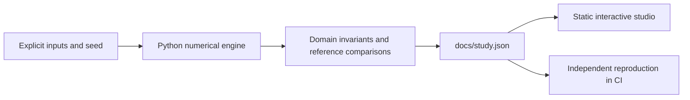

# RegimeLab

Forecasting, uncertainty and adaptation when the data changes.

**[Open the interactive research studio](https://fyodoramanov1.github.io/statistical-learning-lab/)** · [Measured study](docs/study.json) · [Technical case study](reports/applied-study.md) · [Source](src/studio.py)

Build causal forecasting and uncertainty tools that remain interpretable under regime changes, using fundamental ML and useful integrations.

## What you can do

- **Stable regime:** Predict next-day realized variance from six causal return features. Compare a small neural network, regularized regression, persistence and an expanding-window adaptation under a controlled volatility shock.
- **Volatility regime break:** Predict next-day realized variance from six causal return features. Compare a small neural network, regularized regression, persistence and an expanding-window adaptation under a controlled volatility shock.

The interface selects recorded experiments, toggles chart series and exports the comparison table. Each view includes the method, assumptions, provenance and its reproduce command. No API key is required. Market Replay additionally plays the actual book snapshots; the Evidence Observatory performs local retrieval and numeric-claim checks.

## Reproduce

Python 3.12; CPU only. From this repository:

```powershell
python -m pip install -r requirements.txt
python src/studio.py --out docs/study.json
python -m http.server 8000 --directory docs
```

Open `http://localhost:8000`. The static app fetches its local JSON, so use HTTP rather than opening `index.html` directly. No JavaScript build step or package installation is needed.

CI reproduces every applied case with `python src/studio.py --check docs/study.json`, checks numerical invariants and retains the original independent numerical contract. New applied code lives under `src/`; `lab.py` and its original CLI remain compatible for the existing research milestones.

## Recorded findings

### Stable regime

- Frozen ridge MAE: **0.403031 **
- Expanding ridge MAE: **0.403785 **
- Nominal interval coverage: **90 %**
- Observed test coverage: **91.0747 %**

### Volatility regime break

- Frozen ridge MAE: **9.19081 **
- Expanding ridge MAE: **9.83873 **
- Nominal interval coverage: **90 %**
- Observed test coverage: **18.7614 %**

## Design




## Scientific boundaries

Seeded synthetic returns; strictly ordered training, tuning, calibration and held-out targets. All reported models are computed locally with NumPy.

- Synthetic heteroscedastic data tests a known mechanism; it is not a historical market backtest or evidence of alpha. Squared returns are noisy variance proxies.
- Serial dependence and deliberate distribution shift violate exchangeability. Split-conformal intervals here are diagnostics; 90% empirical coverage is not guaranteed under these conditions.
- Mean absolute error, RMSE and QLIKE can rank models differently. QLIKE uses a 10⁻⁵ positivity floor, disclosed because near-zero forecasts can dominate it.
- Only one process seed is shown. Hyperparameters are selected without test data, but broad model selection uncertainty and transaction costs are not quantified.

## Next research questions

- Repeat the volatility forecast protocol across independently generated datasets; freeze selection and report uncertainty.
- Add feature ablations and compare likelihood-aware training objectives without tuning on the final holdout.
- Provide a validated user-CSV forecasting adapter and compare the same causal protocol on licensed public data.

## References

- [A gentle introduction to conformal prediction](https://arxiv.org/abs/2107.07511)
- [Forecasting: principles and practice · time-series cross-validation](https://otexts.com/fpp3/tscv.html)

## Development history

The original baseline and milestone reports are preserved under `reports/`; the applied study is a separate artifact. Results are measured simulations, not claims of live profitability, quantum advantage or independent research novelty. MIT license.
